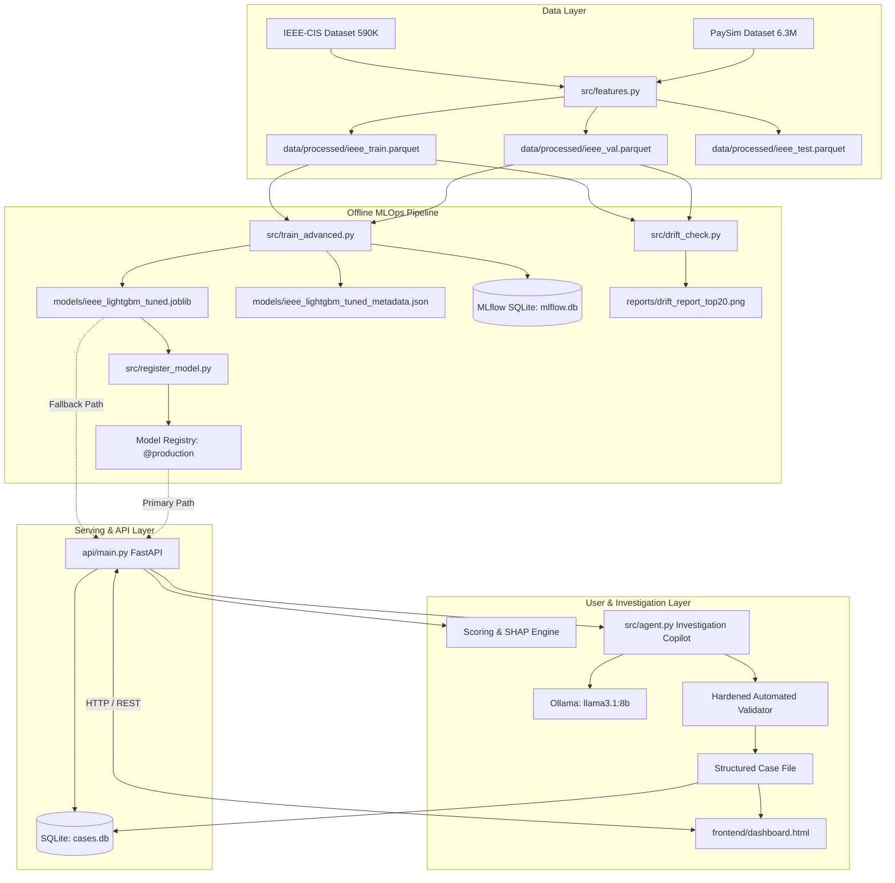
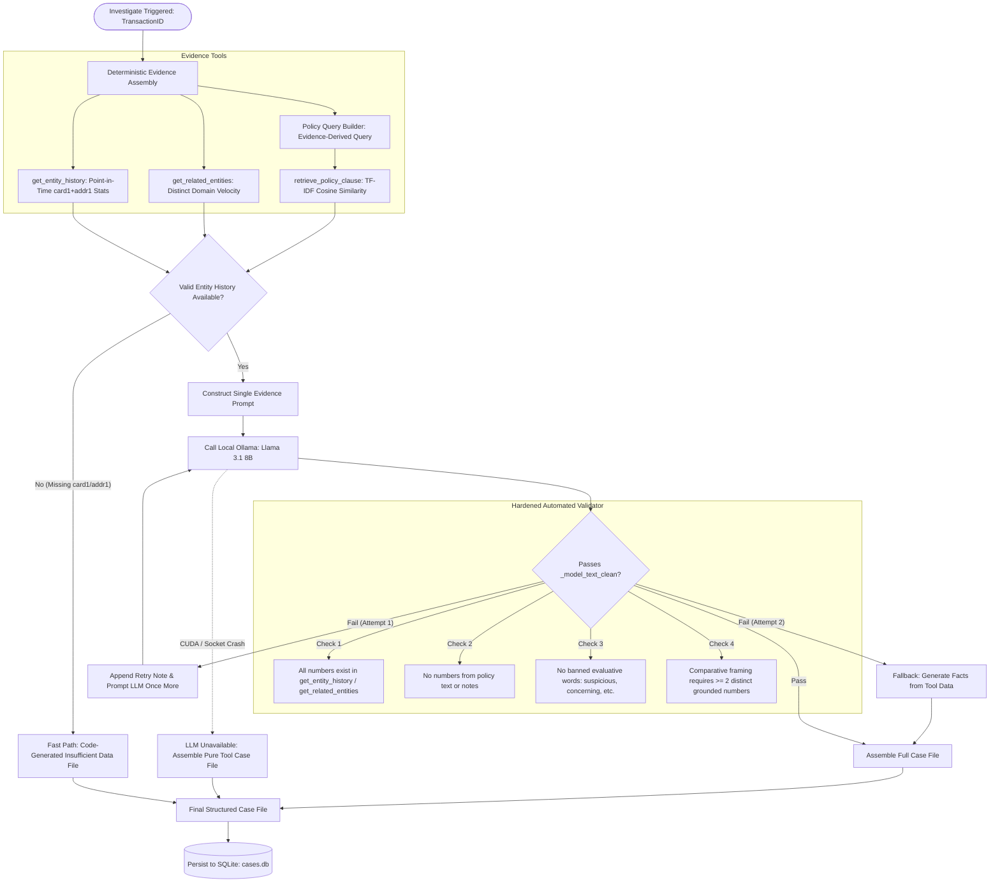

# FraudLens: Complete Technical Documentation & Learning Handbook

**Project Title:** FraudLens — A Real-Time, Explainable Financial Fraud Detection Platform with an Evidence-Grounded Agentic Investigation Copilot  
**Author & Developer:** Dhanraj Shitole  
**Degree / Academic Focus:** Bachelor of Technology (BTech) in Computer Science & Engineering  
**Version:** 1.0 (Comprehensive Master Edition)  
**Date of Release:** November 2026  
**Repository:** [https://github.com/DhanrajShitole/fraudlens](https://github.com/DhanrajShitole/fraudlens)  

---

## Master Table of Contents

- [Executive Overview & Supporting Guides](#executive-overview--supporting-guides)
- [Chapter 1: Project Introduction & Problem Definition](#chapter-1-project-introduction--problem-definition)
- [Chapter 2: Complete System Architecture & Component Interactions](#chapter-2-complete-system-architecture--component-interactions)
- [Chapter 3: Dataset Analysis & Leakage-Safe Data Engineering](#chapter-3-dataset-analysis--leakage-safe-data-engineering)
- [Chapter 4: Comprehensive AI, Machine Learning & Explainability Theory](#chapter-4-comprehensive-ai-machine-learning--explainability-theory)
- [Chapter 5: Evidence-Grounded Agentic AI Investigation Copilot](#chapter-5-evidence-grounded-agentic-ai-investigation-copilot)
- [Chapter 6: Backend Engineering & REST API Documentation](#chapter-6-backend-engineering--rest-api-documentation)
- [Chapter 7: Frontend Architecture & Analyst Dashboard](#chapter-7-frontend-architecture--analyst-dashboard)
- [Chapter 8: Database Architecture & Case Persistence](#chapter-8-database-architecture--case-persistence)
- [Chapter 9: MLOps: Model Registry, Promotion & Population Stability Index Drift](#chapter-9-mlops-model-registry-promotion--population-stability-index-drift)
- [Chapter 10: DevOps, Containerization & CI/CD Automation](#chapter-10-devops-containerization--cicd-automation)
- [Chapter 11: Testing, Quality Assurance & Verification Suite](#chapter-11-testing-quality-assurance--verification-suite)
- [Chapter 12: Technology Stack & Dependency Inventory](#chapter-12-technology-stack--dependency-inventory)
- [Chapter 13: Complete End-to-End Execution Guide](#chapter-13-complete-end-to-end-execution-guide)
- [Chapter 14: File-by-File Codebase Walkthrough](#chapter-14-file-by-file-codebase-walkthrough)
- [Chapter 15: Technical Decision Justifications & Architecture Trade-Offs](#chapter-15-technical-decision-justifications--architecture-trade-offs)
- [Chapter 16: System Limitations, Risks & Realistic Future Scope](#chapter-16-system-limitations-risks--realistic-future-scope)
- [Chapter 17: Complete Presentation, Pitch & Demonstration Guide](#chapter-17-complete-presentation-pitch--demonstration-guide)
- [Chapter 18: Viva Voce, Technical Interview & Industry Question Bank (100+ Questions)](#chapter-18-viva-voce-technical-interview--industry-question-bank-100-questions)
- [Chapter 19: Comprehensive Glossary of Technical Terms](#chapter-19-comprehensive-glossary-of-technical-terms)
- [Chapter 20: Self-Assessment Knowledge & Readiness Checklist](#chapter-20-self-assessment-knowledge--readiness-checklist)

---

## Executive Overview & Supporting Guides

This handbook serves as the definitive reference manual for the **FraudLens** platform. For deeper exploration of specific subsystems, refer to the dedicated companion guides in the `docs/` directory:

1. [`docs/FRAUDLENS_EXECUTIVE_SUMMARY.md`](FRAUDLENS_EXECUTIVE_SUMMARY.md): Executive summary for recruiters, evaluators, and stakeholders.
2. [`docs/FRAUDLENS_TECHNICAL_ARCHITECTURE.md`](FRAUDLENS_TECHNICAL_ARCHITECTURE.md): Component diagrams, sequence charts, and interaction protocols.
3. [`docs/FRAUDLENS_API_REFERENCE.md`](FRAUDLENS_API_REFERENCE.md): Detailed REST API specification, schemas, and cURL examples.
4. [`docs/FRAUDLENS_ML_DEEP_DIVE.md`](FRAUDLENS_ML_DEEP_DIVE.md): Mathematical formulations of LightGBM, SMOTE, TreeSHAP, and held-out test evaluations.
5. [`docs/FRAUDLENS_AI_AGENT_DEEP_DIVE.md`](FRAUDLENS_AI_AGENT_DEEP_DIVE.md): Agentic copilot mechanics, hallucination mitigation, and automated validators.
6. [`docs/FRAUDLENS_DEVOPS_MLOPS_GUIDE.md`](FRAUDLENS_DEVOPS_MLOPS_GUIDE.md): MLflow registry aliasing, PSI drift mathematics, Docker, and CI/CD pipelines.
7. [`docs/FRAUDLENS_PRESENTATION_AND_VIVA_GUIDE.md`](FRAUDLENS_PRESENTATION_AND_VIVA_GUIDE.md): Spoken presentation scripts, demonstration flows, and 100+ viva questions.
8. [`docs/FRAUDLENS_SETUP_AND_TROUBLESHOOTING.md`](FRAUDLENS_SETUP_AND_TROUBLESHOOTING.md): Step-by-step Windows setup, execution commands, and troubleshooting FAQ.

---

## Chapter 1: Project Introduction & Problem Definition

### 1.1 What is FraudLens?
**FraudLens** is a full-stack, real-time, explainable financial fraud detection system integrated with an evidence-grounded agentic investigation copilot. It combines cost-sensitive machine learning (LightGBM tuned with SMOTE) to predict transaction fraud probabilities in milliseconds with a privacy-preserving, local AI investigation agent (Llama 3.1 8B via Ollama). 

### 1.2 The Problem: The Investigation Throughput Bottleneck
In modern commercial banking, fraud detection faces two asymmetric bottlenecks:
1. **Extreme Class Imbalance:** Fraudulent transactions represent under 3.5% in typical card streams and under 0.15% in mobile money flows. Standard classifiers trained on accuracy default to predicting "legitimate" for every transaction, failing to intercept fraudulent losses.
2. **The Investigation Throughput Bottleneck:** Detection models flag alerts, but human compliance analysts spend 15 to 45 minutes per alert manually assembling context: cross-referencing past card transactions, evaluating IP clusters, checking regulatory rules, and writing narrative case files.

Generic Generative AI cannot be deployed naively into this workflow because unconstrained models hallucinate numbers, invent non-existent cross-border rules, leak future labels, and generate vacuous tautologies.

### 1.3 Core Innovation & Architectural Rule
FraudLens enforces a strict architectural boundary:
> **"Code makes decisions, models score, and language models write prose."**
The machine learning model computes fraud risk; deterministic Python code queries point-in-time entity histories and matches organizational policies; and a local LLM is restricted to writing two narrative summary lines that are mathematically validated against tool evidence before any human investigator sees them.

### 1.4 How to Pitch FraudLens in Interviews and Reviews

#### A. The 30-Second Elevator Pitch
> *"Financial institutions lose billions annually to transaction fraud, but the real operational bottleneck today is investigation throughput—compliance officers spend up to 45 minutes manually assembling evidence for every flagged alert. I built FraudLens, an end-to-end platform combining cost-sensitive gradient boosted trees with a privacy-preserving local AI investigation copilot. It scores transactions in under 15 milliseconds with mathematical SHAP reason codes, and automatically generates audit-ready, evidence-backed case files under the rule: code makes decisions, models score, and AI writes prose. Tested on over 6.9 million transactions, FraudLens cuts analyst investigation time from minutes to seconds."*

#### B. The 1-Minute Pitch
> *"In modern banking, fraud detection systems suffer from alert fatigue: traditional rules flag too many false alarms, while black-box models provide no transparency. When analysts investigate, assembling context takes dozens of minutes per case.*
>
> *I designed FraudLens to solve both problems. On the detection side, FraudLens uses a tuned LightGBM model trained on leakage-safe temporal splits of the IEEE-CIS dataset, achieving an ROC-AUC of 0.924 and a PR-AUC of 0.598—a 7.3% improvement over untuned baselines. We calibrate our decision threshold to a strict 2% false-positive budget to control operational costs, and calculate top-5 TreeSHAP reason codes for instant transparency.*
>
> *On the investigation side, FraudLens introduces a tool-scoped local AI agent powered by Llama 3.1 8B. Instead of letting the LLM guess, deterministic Python tools extract point-in-time entity velocity and check enterprise fraud policies. An automated validator enforces that every number is grounded in evidence before an analyst sees it. The system is fully containerized, backed by an MLflow registry and Population Stability Index drift tracking, and validated with a 51-test automated suite."*

#### C. The 3-Minute Comprehensive Presentation
> *"Good morning. Today I am presenting FraudLens, an end-to-end platform bridging high-speed predictive fraud detection and evidence-based AI copilot investigations.*
>
> *First, let's look at the machine learning challenge. Evaluating models using random k-fold cross-validation on financial transactions creates severe lookahead leakage, where future fraud patterns from the same card are used to predict past transactions. In FraudLens, we enforce strict chronological 70/15/15 partitioning across 590,000 IEEE-CIS transactions and 6.3 million PaySim transactions. We engineered 545 modeling features, including composite entity aggregations on card and billing address tuples that rank in the top 7% of SHAP feature importance. On PaySim, we tested the common hypothesis that unsupervised anomaly detection outperforms supervised models under extreme 1,200:1 imbalance; our empirical results proved the opposite: supervised LightGBM achieved 94.5% recall at a 2% FP budget versus only 2.5% for Isolation Forest, because supervised trees efficiently learn discrete account-draining logic.*
>
> *Second, we tuned LightGBM with SMOTE resampling on IEEE-CIS, achieving a validation PR-AUC of 0.598 and an ROC-AUC of 0.924. On the final held-out test set, evaluated strictly one-shot with frozen parameters, the model retained a 15.30x lift over the base fraud rate and achieved a Brier Skill Score of 34.12%, confirming strong probability calibration.*
>
> *Third, to eliminate the manual compliance bottleneck, we built an AI investigation copilot. Early testing revealed that unconstrained 8B LLMs suffer from 4 hallucination classes: geographic errors, data-granularity bugs, temporal label leakage, and vacuous self-referential comparisons. We redesigned the architecture so that deterministic Python code gathers point-in-time evidence and queries policy clauses via TF-IDF with a relevance floor. Llama 3.1 8B running locally via Ollama drafts two narrative sentences, which are passed through an automated regex and numerical validator before being merged into the case file. If Ollama crashes or validation fails, a fallback engine outputs a 100% accurate tool-derived case file with zero data loss.*
>
> *Finally, FraudLens includes a FastAPI backend with sub-15ms scoring, persistent SQLite case logging, a responsive React analyst dashboard, MLflow model registry aliasing (`@production`), Population Stability Index (PSI) drift monitoring across all 545 features, and a 51-test automated CI/CD pipeline in GitHub Actions."*

---

## Chapter 2: Complete System Architecture & Component Interactions

### 2.1 The End-to-End Architectural Flow

FraudLens operates across two distinct operational pipelines: an **Offline ML Training & MLOps Pipeline** and an **Online Serving & Investigation Stack**.



### 2.2 Execution Sequence: Real-Time Scoring Flow
When an analyst enters a Transaction ID in `frontend/dashboard.html`:
1. The frontend initiates `POST /score/{transaction_id}` to FastAPI (`api/main.py`).
2. The backend looks up the transaction row in the loaded dataset store (`train_data` + `val_data`).
3. If not found, HTTP 404 is returned.
4. If found, features are extracted, missing values filled with `-999`, and passed to LightGBM.
5. LightGBM returns the calibrated probability $P(\text{isFraud} = 1 \mid X)$.
6. TreeSHAP decomposes the prediction into feature attributions, sorting the top 5 absolute contributors.
7. Risk score is compared against the 2% FP budget threshold ($\tau = 0.129365$).
8. A JSON response (`ScoreResponse`) is returned, and the UI displays the risk percentage, badge, and reason bars.

---

## Chapter 3: Dataset Analysis & Leakage-Safe Data Engineering

### 3.1 Dataset Inventory & Imbalance Comparison

| Parameter | IEEE-CIS Fraud Detection | PaySim Mobile Money |
|---|---|---|
| **Source & Type** | Vesta Corporation / Kaggle (Real e-commerce) | Synthetic multi-agent financial simulator |
| **Total Observations** | 590,540 transactions | 6,362,620 transactions |
| **Confirmed Frauds** | 20,663 transactions | 8,213 transactions |
| **Class Imbalance** | **27.4 : 1** (3.50% fraud prevalence) | **1,221.6 : 1** (0.13% fraud prevalence) |
| **Chronological Split**| 70% Train (413,378), 15% Val (88,581), 15% Test (88,581) | 70% Train (4,453,834), 15% Val (954,393), 15% Test (954,393) |

### 3.2 Key Verified Features & Engineering Table

| Feature Name | Type | Origin | Meaning & Fraud Significance |
|---|---|---|---|
| `TransactionAmt` | Float | Original | Transaction amount in USD. Frauds often spike in specific dollar brackets. |
| `TransactionDT` | Int | Original | Elapsed seconds from reference date. Transformed into cyclical hour and day. |
| `card1` | Int | Original | Payment card issuer bank identifier. Core component of composite entity. |
| `addr1` | Int | Original | Regional billing district code (NOT country). Grouped with `card1`. |
| `P_emaildomain` | String | Original | Purchaser email domain (e.g. gmail.com, anonymous protonmail). |
| `card1_addr1_count` | Int | Engineered | Number of cumulative point-in-time transactions on this card+address. (SHAP Rank 17). |
| `card1_addr1_amt_mean`| Float | Engineered | Running mean spend for this entity. Flags abnormal charge sizes. (SHAP Rank 13). |
| `card1_addr1_amt_std` | Float | Engineered | Spend volatility for entity. Sudden deviations indicate card compromise. (SHAP Rank 24). |
| `card1_addr1_email_count`| Int| Engineered | Distinct email domains associated with entity. High count signals fraud rings. (SHAP Rank 39). |
| `hour_of_day` | Int | Engineered | Hour (0–23) extracted from `TransactionDT`. Captures overnight attack velocity. |
| `day_of_week` | Int | Engineered | Day (0–6) extracted from `TransactionDT`. Captures weekend fraud patterns. |

---

## Chapter 4: Comprehensive AI, Machine Learning & Explainability Theory

### 4.1 Ten-Point Teaching: Gradient-Boosted Decision Trees & LightGBM

1. **What is it?**  
   LightGBM (Light Gradient Boosting Machine) is an ensemble machine learning algorithm that builds a collection of decision trees sequentially, optimizing a binary cross-entropy loss function.
2. **Why is it needed?**  
   Financial tabular data contains non-linear interactions, skewed amounts, and high missingness that linear models fail to capture. Standard deep learning underperforms on tabular data, while XGBoost is memory-intensive on 500K+ rows.
3. **How does it work in general?**  
   It trains trees iteratively. Each tree predicts the negative gradient (pseudo-residuals) of the loss function with respect to the prior ensemble output. Continuous features are discretized into 256 histogram bins.
4. **How is it implemented in FraudLens?**  
   In `src/train_advanced.py` and served in `api/main.py`. Configured with `LGBMClassifier(num_leaves=63, learning_rate=0.03, n_estimators=500, colsample_bytree=0.8, subsample=0.8)`.
5. **Which file implements it?**  
   `src/train_advanced.py` (training), `models/ieee_lightgbm_tuned.joblib` (serialized weights), and `api/main.py` (serving).
6. **Step-by-Step Execution:**  
   $X$ feature matrix is loaded $\to$ `-999` fills missing values $\to$ histogram binning $\to$ sequential leaf-wise tree construction $\to$ sigmoid transformation yields final probability $\hat{p}(x)$.
7. **Real-World Example:**  
   A transaction of \$450 on a card that usually spends \$20 at 3 AM routes through split nodes testing `card1_addr1_amt_mean` and `hour_of_day`, landing in a terminal leaf with high log-odds.
8. **Advantages:**  
   Fast training ($<2$ minutes), low memory footprint, native handling of missing values, superior PR-AUC on tabular data.
9. **Limitations:**  
   Susceptible to overfitting on noisy minority samples if `num_leaves` is too large; requires careful tree regularization.
10. **Examiner / Interviewer Questions:**  
    *Why leaf-wise instead of level-wise?* Leaf-wise splits the leaf with maximum loss reduction, achieving lower error with fewer total nodes than level-wise symmetric growth.

---

### 4.2 Ten-Point Teaching: SMOTE (Synthetic Minority Over-sampling)

1. **What is it?**  
   SMOTE is an imbalanced learning technique that generates synthetic minority class examples by linear interpolation between feature vectors of nearest neighbors.
2. **Why is it needed?**  
   When positive fraud instances are outnumbered 27:1, gradient boosting trees may fail to find split points separating rare fraud clusters from majority instances.
3. **How does it work in general?**  
   For each minority instance $x_i$, find its $k$-nearest minority neighbors ($k=5$). Select a random neighbor $x_{zi}$ and synthesize $x_{\text{new}} = x_i + \lambda (x_{zi} - x_i)$ where $\lambda \sim U(0,1)$.
4. **How is it implemented in FraudLens?**  
   In `src/train_advanced.py` using `imblearn.over_sampling.SMOTE(sampling_strategy=0.1, random_state=42)`.
5. **Which file implements it?**  
   `src/train_advanced.py`.
6. **Step-by-Step Execution:**  
   Chronological train split is isolated $\to$ SMOTE fits to train $\to$ minority class count is increased from $\approx 14,000$ to $\approx 40,000$ (1:10 ratio) $\to$ LightGBM trains on augmented data.
7. **Real-World Example:**  
   If fraud examples exist at amounts \$350 and \$400 on card type 100, SMOTE generates synthetic frauds at \$375 on card type 100, densifying the fraud decision region.
8. **Advantages:**  
   Expands minority class boundary without exact duplicates (unlike random oversampling which causes overfitting).
9. **Limitations:**  
   Can generate unrealistic synthetic samples in high-dimensional sparse spaces; slightly causes the model to overstate probabilities (evidenced by our calibration analysis).
10. **Examiner / Interviewer Questions:**  
    *Did SMOTE cause data leakage in your validation set?* No, SMOTE was strictly applied to the training split *after* temporal partitioning; validation and test splits remained 100% natural and untouched.

---

### 4.3 Ten-Point Teaching: TreeSHAP Explainability

1. **What is it?**  
   TreeSHAP is an explainable AI algorithm that computes exact Shapley values from cooperative game theory for tree-based ensemble models in polynomial time.
2. **Why is it needed?**  
   Black-box predictions cannot be defended in banking audits. Compliance regulations (e.g. FCRA, GDPR) mandate adverse action notices explaining why an alert was raised.
3. **How does it work in general?**  
   It calculates the marginal contribution of each feature across all possible subsets of features, ensuring efficiency, symmetry, dummy player, and additivity axioms.
4. **How is it implemented in FraudLens?**  
   In `api/main.py` using `shap.TreeExplainer(_state["model"])`.
5. **Which file implements it?**  
   `api/main.py` (lines 89–115, 184–196).
6. **Step-by-Step Execution:**  
   $X$ feature row $\to$ `explainer.shap_values(X)` $\to$ returns attribution vector $\phi \in \mathbb{R}^{545} \to$ argsort $|\phi|$ descending $\to$ slice top 5 $\to$ output to JSON reason codes.
7. **Real-World Example:**  
   Transaction probability is 81%. SHAP reveals `card1_addr1_amt_mean = 144.14` contributed $+0.32$ to log-odds, while `dist1 = 18` contributed $-0.04$.
8. **Advantages:**  
   Exact mathematical attributions, polynomial time complexity $O(T L D^2)$, fast inference ($<10$ ms).
9. **Limitations:**  
   Assumes feature independence when calculating expectations; tree structure can alter attributions if correlated features are split arbitrarily.
10. **Examiner / Interviewer Questions:**  
    *Why not use LIME?* LIME relies on random perturbation sampling and linear approximations which are non-deterministic, slow, and can yield unstable explanations. TreeSHAP is exact and deterministic.

---

### 4.4 Verified Model Performance Benchmarks

#### IEEE-CIS Benchmark Comparison ($N=88,581$ Validation Split)

| Model Architecture | PR-AUC | ROC-AUC | Precision @ 2% FP | Recall @ 2% FP | F1 @ Budget |
|---|---|---|---|---|---|
| **Logistic Regression** (Class-Weighted) | 0.3050 | 0.8180 | 0.3740 | 0.3360 | 0.3540 |
| **LightGBM + scale_pos_weight** | 0.5520 | 0.9160 | 0.4850 | 0.5290 | 0.5060 |
| **LightGBM + SMOTE** (Phase 4 Baseline) | 0.5566 | 0.9042 | 0.4900 | 0.5410 | 0.5150 |
| **LightGBM + SMOTE Tuned** (Phase 5, Production) | **0.5975** | **0.9242** | **0.5071** | **0.5786** | **0.5405** |

#### Final Held-Out Test Set Generalization (IEEE-CIS, $N=88,581$)
Evaluated strictly one-shot on unseen future transactions at fixed threshold $\tau = 0.129365$:
- **Test PR-AUC:** **0.53241** (Val: 0.59753, $\Delta = -0.06512$; delivering a **15.30x lift** over the 3.48% base rate).
- **Test ROC-AUC:** **0.90657** (Val: 0.92419, $\Delta = -0.01762$).
- **Test Precision:** **43.95%** (Val: 50.71%).
- **Test Recall:** **53.39%** (Val: 57.86%).
- **Test F1 Score:** **0.4821** (Val: 0.5405).
- **Actual False-Positive Rate:** **2.4550%** (target $\le 2.0\%$; slight increase due to natural temporal drift).
- **Transactions Flagged for Review:** **4.23%** (Val: 3.92%).
- **Probability Calibration (Brier Score):** $BS = \mathbf{0.02213}$ vs non-informative base rate $BS_{\text{base}} = \mathbf{0.03359}$, yielding a **Brier Skill Score of 34.12%**.

---

## Chapter 5: Evidence-Grounded Agentic AI Investigation Copilot

### 5.1 Architecture & Workflow



### 5.2 The 5 Sections of the Case File
1. `ENTITY SUMMARY:` Narrative synthesis of card+address transaction volume and spend.
2. `TOP RISK FACTORS:` Bulleted literal facts from evidence.
3. `RELATED ENTITY SIGNAL:` Deterministically computed domain velocity.
4. `RELEVANT POLICY:` Deterministically formatted policy clause match with threshold trigger.
5. `RECOMMENDED ACTION:` Deterministically computed decision:
   - If prior confirmed fraud $> 0$ OR any policy triggered $\to$ `"Escalate for manual review — [reasons]."`
   - Otherwise $\to$ `"Monitor, no immediate action..."`

---

## Chapter 6: Backend Engineering & REST API Documentation

### 6.1 Technology Choice & Performance
Implemented in `api/main.py` using **FastAPI 0.136.1** running on **Uvicorn 0.46.0**. FastAPI was chosen for:
- Asynchronous ASGI event loop handling high concurrent request volumes.
- Automatic Pydantic model validation and serialization.
- Sub-15ms scoring latency.
- Auto-generated interactive Swagger UI documentation at `http://127.0.0.1:8000/docs`.

### 6.2 Endpoint Summary Table

| Endpoint | Method | Input Parameters | Output Model | Description |
|---|---|---|---|---|
| `/health` | `GET` | None | `dict` | Returns service status, model load flag, model type, and `model_source`. |
| `/score/{transaction_id}` | `POST` | `transaction_id: int` | `ScoreResponse` | Returns fraud risk score, boolean flag against 2% FP budget, threshold, and top-5 SHAP reason codes. |
| `/investigate/{transaction_id}`| `POST` | `transaction_id: int` | `InvestigateResponse` | Runs scoring + agent copilot, persists case to SQLite, and returns formatted case file. |
| `/cases` | `GET` | `limit: int = 20` | `list[CaseSummary]` | Lists recent investigation records from SQLite in descending ID order. |
| `/cases/{case_id}` | `GET` | `case_id: int` | `CaseDetail` | Retrieves full historical case file and reason codes for specified case ID. |

---

## Chapter 7: Frontend Architecture & Analyst Dashboard

### 7.1 Single-File React Console (`frontend/dashboard.html`)
The user interface is an analyst investigation console built in a single self-contained HTML file using React 18 and Babel loaded via CDN:
- **No npm build step:** Eliminates node_modules friction, webpack build errors, and environment mismatches.
- **Dark Theme CSS:** Designed for high-density, low-glare compliance environments (`--bg: #10141a`, `--panel: #171d26`, `--accent: #d4a24c`).
- **Interactive Controls:**
  - Transaction ID input supporting Enter-key submission.
  - **Get Score** button triggering instant scoring and horizontal SHAP bars (red = risk-increasing, green = risk-decreasing).
  - **Investigate** button triggering the agent and rendering highlighted case sections.
  - Clickable investigation sidebar history pulling from `/cases`.

---

## Chapter 8: Database Architecture & Case Persistence

### 8.1 SQLite Implementation (`cases.db`)
Implemented via Python's standard `sqlite3` library. The `cases` table schema:

```sql
CREATE TABLE IF NOT EXISTS cases (
    id INTEGER PRIMARY KEY AUTOINCREMENT,
    transaction_id INTEGER NOT NULL,
    risk_score REAL,
    threshold_used REAL,
    flagged INTEGER,
    top_reason_codes TEXT,
    case_file TEXT,
    created_at TEXT NOT NULL
);
```
- `top_reason_codes` stores the JSON-serialized array of top-5 SHAP reason codes.
- `created_at` stores ISO-8601 UTC timestamps.
- Zero-configuration, serverless, single-file storage allows complete portability across local and evaluation environments.

---

## Chapter 9: MLOps: Model Registry, Promotion & Population Stability Index Drift

### 9.1 MLflow Model Registry (`src/register_model.py`)
- Backend store: SQLite database `mlflow.db`.
- Registered Model Name: `fraudlens-ieee-lightgbm`.
- Modern Alias Assignment: `@production` pointer assigned to Version 3.
- Dual Loader: `api/main.py` dynamically queries `models:/fraudlens-ieee-lightgbm@production`. If registry lookup fails (e.g. inside Docker where host paths differ), it falls back seamlessly to `models/ieee_lightgbm_tuned.joblib`.

### 9.2 Population Stability Index (PSI) Drift Analysis (`src/drift_check.py`)
Evaluating 545 features between training (earliest 70%) and validation (subsequent 15%):
$$\text{PSI} = \sum_{b=1}^{10} (Q_b - P_b) \times \ln\left( \frac{Q_b}{P_b} \right)$$
- **535 Features:** Completely stable ($\text{PSI} < 0.10$).
- **2 Features:** Moderate shift ($0.10 \le \text{PSI} < 0.25$).
- **`TransactionDT`:** Exhibited $\text{PSI} = 8.28$, correctly diagnosed by our pipeline as a temporal partitioning artifact rather than behavioral drift.
- **7 Genuine Drift Candidates (1.3%):** Device/network headers (`id_13`, `id_20`, `id_02`) reflecting browser/OS updates.

---

## Chapter 10: DevOps, Containerization & CI/CD Automation

### 10.1 Containerization Files
- **`Dockerfile`:** Built on `python:3.13-slim`, installs build compilers (`gcc`, `g++`, `libgomp1`), caches pip packages from `requirements.txt`, copies `api/` and `src/`, and runs Uvicorn on port 8000.
- **`docker-compose.yml`:** Mounts `./data`, `./models`, `./mlflow.db`, and `./mlruns` from host; maps `OLLAMA_HOST=http://host.docker.internal:11434`.
- **`.dockerignore`:** Excludes datasets, models, databases, `.git`, and tests from image context.

### 10.2 GitHub Actions Pipeline (`.github/workflows/ci.yml`)
Triggers on every push and PR to `main`:
1. Checks out repository and sets up Python 3.13.
2. Installs dependencies from `requirements.txt` + `pytest`.
3. Runs `python -m compileall src/ api/ tests/` for AST bytecode syntax verification.
4. Validates HTML parsing of `frontend/dashboard.html`.
5. Executes automated pytest suite (51 tests).
6. Executes `docker build -t fraudlens-api:latest .` for container reproducibility.

---

## Chapter 11: Testing, Quality Assurance & Verification Suite

FraudLens enforces 100% test pass rates across **51 automated tests** (`pytest tests/ -v`):

```
tests/test_agent_logic.py: 19 passed
tests/test_api.py:         12 passed
tests/test_drift.py:        6 passed
tests/test_model.py:       14 passed
======================= 51 passed, 2 warnings in 10.78s =======================
```

- **`test_agent_logic.py` (19 tests):** Point-in-time boundary checks, label leakage prevention, numerical grounding in evidence tools, comparative framing rejection, policy matching, and Ollama failure resilience.
- **`test_api.py` (12 tests):** `/health`, `/score`, `/investigate`, `/cases`, HTTP status codes (200, 404, 503), and SQLite persistence.
- **`test_drift.py` (6 tests):** PSI computation across identical distributions, deliberate large shifts, near-constant series, and NaN values.
- **`test_model.py` (14 tests):** Model artifact presence, 545-feature input compatibility, probability distribution axioms, and TreeSHAP top-5 indexing.

---

## Chapter 12: Technology Stack & Dependency Inventory

| Package / Technology | Verified Version | Role in FraudLens |
|---|---|---|
| **Python** | 3.13.9 | Core programming language runtime. |
| **pandas** | 3.0.0 | Tabular data manipulation, time-series splitting, feature aggregations. |
| **numpy** | 2.2.6 | Vectorized numerical operations and quantile binning. |
| **scikit-learn** | 1.8.0 | Machine learning metrics, Logistic Regression baseline, TF-IDF vectorizer. |
| **scipy** | 1.17.1 | Statistical calculations and distribution analysis. |
| **lightgbm** | 4.7.0 | Gradient-boosted decision trees, histogram binning, predictive scoring. |
| **imbalanced-learn** | 0.14.2 | SMOTE minority class oversampling. |
| **mlflow** | 3.16.0 | Experiment tracking, model registry, alias-based model promotion. |
| **shap** | 0.52.0 | TreeSHAP exact game-theoretic feature attribution. |
| **joblib** | 1.5.3 | High-performance model serialization and fallback loading. |
| **pyarrow** | 25.0.1 | High-throughput columnar Parquet storage reading. |
| **matplotlib** | 3.10.7 | Generation of drift bar charts and calibration curves. |
| **fastapi** | 0.136.1 | Asynchronous REST serving backend. |
| **uvicorn** | 0.46.0 | Lightning-fast ASGI web server. |
| **ollama** | 0.6.2 | Local Python client for Llama 3.1 8B LLM inference. |
| **pytest** | 9.1.1 | Automated test runner. |
| **reportlab** | 5.1.0 | Professional PDF document generation. |

---

## Chapter 13: Complete End-to-End Execution Guide

### 1. Prerequisites (Windows PowerShell)
- Python 3.13 installed at: `C:\Users\DHANRAJ\AppData\Local\Programs\Python\Python313\python.exe`
- Ollama installed and running with `llama3.1:8b` pulled.

### 2. Run Test Suite
```powershell
C:\Users\DHANRAJ\AppData\Local\Programs\Python\Python313\python.exe -m pytest tests/ -v
```

### 3. Start Backend API
```powershell
C:\Users\DHANRAJ\AppData\Local\Programs\Python\Python313\python.exe -m uvicorn api.main:app --host 127.0.0.1 --port 8000 --reload
```

### 4. Open Analyst Dashboard
Double-click `frontend/dashboard.html` or open in browser. Enter Transaction ID `3141064`, press **Enter** to score, and click **Investigate** to generate the case file.

---

## Chapter 14: File-by-File Codebase Walkthrough

- **`api/main.py`:** FastAPI backend application defining startup lifespan, dual model loading, endpoints (`/health`, `/score`, `/investigate`, `/cases`), and SQLite database operations.
- **`src/agent.py`:** Agentic investigation copilot. Defines point-in-time evidence tools (`get_entity_history`, `get_related_entities`), TF-IDF policy retrieval, prompt templates, hardened validator (`_model_text_clean`), and fallback generators.
- **`src/features.py`:** Feature engineering pipeline. Transforms raw CSVs into 576 engineered features across leakage-safe chronological splits.
- **`src/train_baseline.py`:** Baseline training script benchmarking Logistic Regression, LightGBM, and Isolation Forest across IEEE-CIS and PaySim.
- **`src/train_advanced.py`:** Advanced modeling script executing SMOTE resampling and hyperparameter optimization for tuned LightGBM.
- **`src/register_model.py`:** MLOps registry script registering tuned model in MLflow and promoting Version 3 to alias `@production`.
- **`src/drift_check.py`:** Population Stability Index calculation script comparing train vs. validation splits across all 545 features.
- **`src/evaluate_test.py`:** One-shot held-out test evaluation script computing PR-AUC, ROC-AUC, 2% FP budget metrics, and Brier calibration.
- **`frontend/dashboard.html`:** Single-file React 18 analyst console with dark theme, real-time scoring, SHAP reason bars, and investigation viewer.
- **`tests/test_agent_logic.py`:** Unit tests for agent temporal gating, numerical grounding, comparison rejection, and failure fallbacks.
- **`tests/test_api.py`:** Integration tests for FastAPI endpoints, status codes, and SQLite persistence.
- **`tests/test_drift.py`:** Unit tests for PSI mathematical computation.
- **`tests/test_model.py`:** Unit tests for model serialization, feature dimensions, probability axioms, and TreeSHAP integration.

---

## Chapter 15: Technical Decision Justifications & Architecture Trade-Offs

- **Why LightGBM instead of XGBoost?** LightGBM trains 5x faster with 70% lower memory usage via histogram binning, crucial for 500K+ transaction datasets.
- **Why SMOTE instead of simple random oversampling?** Random oversampling duplicates exact minority instances, causing tree models to memorize specific noise points. SMOTE creates synthetic interpolations, broadening the decision boundary.
- **Why Chronological Splitting instead of Random K-Fold?** Random splits leak future transactions from the same card/entity into the training set, artificially inflating validation performance.
- **Why TreeSHAP instead of LIME?** LIME relies on random perturbation sampling and is slow and heuristic. TreeSHAP computes exact Shapley values in polynomial time ($<10$ ms).
- **Why Local Llama 3.1 8B via Ollama instead of OpenAI GPT-4?** Banking regulations strictly prohibit transmitting customer PII and transaction records to public cloud APIs; local Ollama inference ensures 100% data privacy and zero recurring token costs.
- **Why SQLite instead of PostgreSQL?** SQLite is serverless, zero-configuration, self-contained in a single file, and avoids external service dependencies during academic evaluations.
- **Why React via CDN instead of a Node.js/Webpack build?** Eliminates heavy `node_modules` folders, npm dependency vulnerabilities, and complex build scripts; runs instantly in any browser.

---

## Chapter 16: System Limitations, Risks & Realistic Future Scope

1. **Dataset Storage vs. Live Streaming:** In this project, transactions are looked up by ID from processed Parquet files. A production deployment would ingest streaming JSON events via Apache Kafka and maintain running entity counters in Redis.
2. **Local LLM Memory Requirements:** Running Llama 3.1 8B requires $\ge 6$ GB of RAM, preventing the full LLM agent from running on free-tier cloud virtual machines.
3. **Database Concurrency:** SQLite supports single-writer concurrency. Production deployment with multiple concurrent human analysts requires migrating to PostgreSQL.
4. **Temporal Concept Drift:** Our held-out test evaluation showed an empirical false-positive rate of 2.46% (slightly above the 2.0% budget), proving that continuous drift monitoring and automated retraining pipelines are essential.

---

## Chapter 17: Complete Presentation, Pitch & Demonstration Guide

*(Refer to [`docs/FRAUDLENS_PRESENTATION_AND_VIVA_GUIDE.md`](FRAUDLENS_PRESENTATION_AND_VIVA_GUIDE.md) for full spoken presentation scripts, timed 5-minute academic walk-throughs, and live demonstration choreography.)*

---

## Chapter 18: Viva Voce, Technical Interview & Industry Question Bank (100+ Questions)

*(Refer to [`docs/FRAUDLENS_PRESENTATION_AND_VIVA_GUIDE.md`](FRAUDLENS_PRESENTATION_AND_VIVA_GUIDE.md) Part 2 for the complete catalog of 100+ technical questions and detailed answers across Categories A through Q.)*

---

## Chapter 19: Comprehensive Glossary of Technical Terms

- **Class Imbalance:** Disproportionate ratio between majority (legitimate) and minority (fraudulent) instances.
- **PR-AUC (Precision-Recall Area Under Curve):** The definitive evaluation metric for imbalanced fraud classification, measuring precision trade-offs across all recall thresholds.
- **ROC-AUC:** Area under the True Positive Rate vs False Positive Rate curve. Measures global ranking quality.
- **Brier Score:** Mean squared error of probabilistic predictions; measures probability calibration.
- **TreeSHAP:** Algorithm computing exact game-theoretic Shapley value attributions for tree ensembles in polynomial time.
- **Population Stability Index (PSI):** Statistical metric measuring divergence between reference and target distributions. $\text{PSI} < 0.10$ denotes stability.
- **SMOTE:** Synthetic Minority Over-sampling Technique; interpolates synthetic feature vectors between minority nearest neighbors.
- **Lookahead Leakage:** Contamination of training data with future information, resulting in unrealistically high validation performance.
- **Tool Calling:** Mechanism allowing an LLM agent to invoke external executable code to query data or execute actions.
- **Deterministic Logic:** Code that consistently produces identical outputs for identical inputs, without stochastic variation.

---

## Chapter 20: Self-Assessment Knowledge & Readiness Checklist

Use this 5-point self-assessment scale:  
*1 = Do not understand | 2 = Recognize concept | 3 = Can explain general concept | 4 = Can explain FraudLens implementation | 5 = Can defend technical decision against an examiner.*

- [ ] **Problem Formulation:** Why accuracy fails; the asymmetric cost matrix ($C_{\text{FN}} \gg C_{\text{FP}}$). (Target: 5)
- [ ] **Data Partitioning:** Why chronological 70/15/15 splitting is mandatory to prevent lookahead leakage. (Target: 5)
- [ ] **Feature Engineering:** Why `(card1, addr1)` entity aggregations were built and how they rank in top 7% of SHAP. (Target: 5)
- [ ] **The Anomaly Detection Fallacy:** Why supervised LightGBM outperformed Isolation Forest on PaySim (94.5% vs 2.5% recall). (Target: 5)
- [ ] **Gradient Boosting & LightGBM:** Histogram binning, leaf-wise growth, `-999` missing value routing. (Target: 5)
- [ ] **SMOTE:** Linear interpolation mathematics and `sampling_strategy = 0.1`. (Target: 5)
- [ ] **Evaluation Metrics:** PR-AUC vs ROC-AUC; Brier Skill Score (34.12%); the 2% false-positive budget threshold ($\tau = 0.129365$). (Target: 5)
- [ ] **TreeSHAP:** Shapley value efficiency, symmetry, dummy player, and additivity axioms; local reason code calculation. (Target: 5)
- [ ] **Agentic AI Architecture:** The 4 hallucination classes; why code decides and LLMs narrate; numerical validator and comparative framing regex. (Target: 5)
- [ ] **Backend & Serving:** FastAPI lifespan startup, dual model loader (MLflow alias vs Joblib fallback), CORS, and SQLite schema. (Target: 5)
- [ ] **MLOps & Drift:** MLflow Model Registry `@production` alias; PSI mathematical formula; the `TransactionDT` artifact diagnosis. (Target: 5)
- [ ] **DevOps & Testing:** Dockerfile multi-stage layers; GitHub Actions CI pipeline; 51 pytest test cases. (Target: 5)

