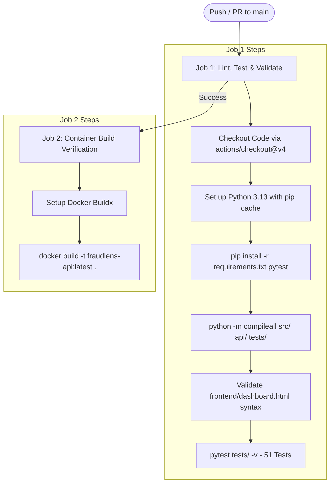

# FraudLens — DevOps, MLOps & Production Engineering Guide

**Author:** Dhanraj Shitole  
**Target Audience:** DevOps Engineers, MLOps Engineers, System Administrators  
**Components Covered:** MLflow Model Registry, PSI Drift Detection, Docker, GitHub Actions CI/CD  

---

## 1. MLOps Architecture & Model Registry

In mission-critical financial applications, saving a model as an untracked local binary file introduces severe operational hazards:
- Lack of traceability: No audit trail connecting a serving binary to the training dataset, commit hash, or hyperparameter configuration.
- Stale deployments: Difficulty in rolling back or staging new model candidates without downtime.

FraudLens integrates **MLflow (v3.16.0)** with an embedded SQLite backend (`mlflow.db`).

### 1.1 Model Registration & Modern Aliasing (`src/register_model.py`)
Earlier versions of MLflow utilized stage-based promotion (`Staging`, `Production`, `Archived`). MLflow 2.9+ deprecated stages in favor of the **Model Aliases API**:
1. The tuned model is logged under experiment `FraudLens_IEEE-CIS`.
2. Model parameters (`threshold_2pct_fp_budget`, `n_features`, `model_type`) are logged alongside the model artifact.
3. The model is registered in the central registry as `fraudlens-ieee-lightgbm`.
4. The client assigns the mutable pointer `@production` to the target version:
   ```python
   client.set_registered_model_alias(
       name="fraudlens-ieee-lightgbm",
       alias="production",
       version=latest_version
   )
   ```

### 1.2 Dual Serving Loader in `api/main.py`
The FastAPI application implements a resilient dual-path loader during startup:
```python
mlflow.set_tracking_uri(f"sqlite:///{os.path.join(BASE_DIR, 'mlflow.db')}")
try:
    # 1. Primary Path: Load active production model by alias
    registry_model = mlflow.lightgbm.load_model("models:/fraudlens-ieee-lightgbm@production")
    if not hasattr(registry_model, "predict_proba"):
        raise ValueError("Registry model has no predict_proba method.")
    shap.TreeExplainer(registry_model)  # Verify SHAP compatibility
    _state["model"] = registry_model
    _state["model_source"] = "registry:fraudlens-ieee-lightgbm@production"
except Exception as _reg_err:
    # 2. Fallback Path: Load static joblib artifact
    print(f"Falling back to local joblib model ({_reg_err}).")
    _state["model"] = joblib.load(os.path.join(MODELS_DIR, "ieee_lightgbm_tuned.joblib"))
    _state["model_source"] = "joblib-fallback"
```
*Why Fallback Is Critical:* Inside lightweight Docker containers or remote virtual environments, SQLite tracking databases often contain host-specific absolute paths to artifacts that cannot be resolved. The fallback guarantees 100% service uptime.

---

## 2. Drift Monitoring via Population Stability Index (`src/drift_check.py`)

Financial transaction patterns drift over time due to seasonal consumer habits, infrastructure updates, and emerging fraud vectors. FraudLens calculates the **Population Stability Index (PSI)** to monitor feature drift without requiring heavy external dependencies (e.g., Evidently AI).

### 2.1 Mathematical Formulation
Let $P$ represent the reference distribution (Training split, earliest 70%) and $Q$ represent the comparison distribution (Validation split, subsequent 15%). Continuous features are discretized into $B = 10$ quantile bins defined strictly by the reference distribution:

$$\text{PSI} = \sum_{b=1}^{B} \left( Q_b - P_b \right) \times \ln\left( \frac{Q_b}{P_b} \right)$$

Where:
- $P_b$ is the proportion of reference observations falling into bin $b$.
- $Q_b$ is the proportion of comparison observations falling into bin $b$.
- Values are clipped to a floor of $\epsilon = 10^{-4}$ to prevent division by zero or undefined logarithms.

### 2.2 Standard Industrial Thresholds
- **$\text{PSI} < 0.10$:** Negligible shift; distribution is stable.
- **$0.10 \le \text{PSI} < 0.25$:** Moderate shift; flag for visual inspection.
- **$\text{PSI} \ge 0.25$:** Significant distribution shift; investigate root cause and trigger model retraining.

### 2.3 Empirical Results (Train vs. Validation Drift)
Evaluating all 545 candidate features across 501,959 transactions:
- **Stable ($\text{PSI} < 0.10$):** **535 features** (98.2% of feature space).
- **Moderate Shift ($0.10 \le \text{PSI} < 0.25$):** **2 features** (`id_31`, `card4`).
- **Initial Flagged Features ($\text{PSI} \ge 0.25$):** **8 features**.

#### Diagnosing the `TransactionDT` Tautological Artifact:
The highest calculated PSI occurred on `TransactionDT` ($\text{PSI} = 8.28$). However, `TransactionDT` is the chronological time variable itself, which was explicitly used to split train (earliest 70%) from validation (next 15%). The two distributions have completely disjoint supports by mathematical definition. Reporting this as "data drift" would be a severe analytical error; our pipeline correctly isolates it as an expected temporal partitioning artifact.

#### Genuine Drift Candidates:
Excluding `TransactionDT`, exactly **7 features (1.3%)** exhibit genuine drift:
1. `id_13`, `id_20`, `id_02`: Device and network fingerprint headers. Plausibly explained by changes in browser versions, mobile OS updates, or telemetry SDK updates across collection epochs.
2. `V151`, `V160`, `V144`, `V143`, `V166`, `V164`: Anonymized V-series features reflecting payment gateway metadata.

Outputs: Persisted to [`reports/drift_report_train_vs_val.csv`](file:///c:/Users/DHANRAJ/fraudlens/reports/drift_report_train_vs_val.csv) and [`reports/drift_report_top20.png`](file:///c:/Users/DHANRAJ/fraudlens/reports/drift_report_top20.png).

---

## 3. Containerization Architecture (Docker & Docker Compose)

FraudLens provides complete local containerization for the scoring backend and database layers.

### 3.1 Dockerfile Specification (`Dockerfile`)
```dockerfile
FROM python:3.13-slim

WORKDIR /app

# Install OS build dependencies required for compiling wheels
RUN apt-get update && apt-get install -y --no-install-recommends \
        gcc \
        g++ \
        libgomp1 \
    && rm -rf /var/lib/apt/lists/*

# Layer caching: Copy requirements first
COPY requirements.txt .
RUN pip install --no-cache-dir -r requirements.txt

# Copy application source code only
COPY api/ api/
COPY src/ src/

EXPOSE 8000
CMD ["uvicorn", "api.main:app", "--host", "0.0.0.0", "--port", "8000"]
```

### 3.2 Docker Compose (`docker-compose.yml`)
```yaml
services:
  api:
    build: .
    ports:
      - "8000:8000"
    volumes:
      # Mount runtime data and models; do not bake multi-GB files into image
      - ./data:/app/data
      - ./models:/app/models
      - ./mlflow.db:/app/mlflow.db
      - ./mlruns:/app/mlruns
    environment:
      # Point to local host Ollama service
      - OLLAMA_HOST=http://host.docker.internal:11434
```

### 3.3 Context Optimization (`.dockerignore`)
To keep build context transfer times sub-second, multi-gigabyte datasets, models, databases, and dev caches are excluded:
```
data/
models/
mlruns/
mlflow.db
cases.db
.git
__pycache__
tests/
notebooks/
reports/
frontend/
*.pyc
.pytest_cache/
```

---

## 4. Continuous Integration Pipeline (GitHub Actions)

Located at [`.github/workflows/ci.yml`](file:///c:/Users/DHANRAJ/fraudlens/.github/workflows/ci.yml). Automatically triggered on every push and pull request to branch `main`.



---

## 5. Production Cloud Deployment Topology

### Hybrid Cloud Strategy
Running an 8-billion parameter LLM requires $\ge 6$ GB of RAM, rendering free or entry-level cloud instances (e.g. AWS t2.micro with 1GB RAM) infeasible for hosting the LLM directly. FraudLens designs a realistic, production-viable hybrid topology:

```
[ Public Internet / Clients ]
              │
              ▼
    ┌───────────────────┐
    │  Cloud Host       │ (e.g. AWS Fargate, Render, Fly.io, or Railway)
    │  • FastAPI (8000) │ RAM: 512 MB - 1 GB
    │  • LightGBM Model │ CPU: 0.5 - 1 vCPU
    │  • TreeSHAP       │ Latency: < 15ms
    └─────────┬─────────┘
              │
              │ (Secure VPN / mTLS / Private Enterprise Network)
              ▼
    ┌───────────────────┐
    │  On-Premise Host  │ (Internal Banking Core / High-RAM Instance)
    │  • Ollama Daemon  │ RAM: 8 GB - 16 GB
    │  • Llama 3.1 8B   │ Zero Cloud PII Egress
    │  • Private DB     │ Regulatory Compliant
    └───────────────────┘
```

