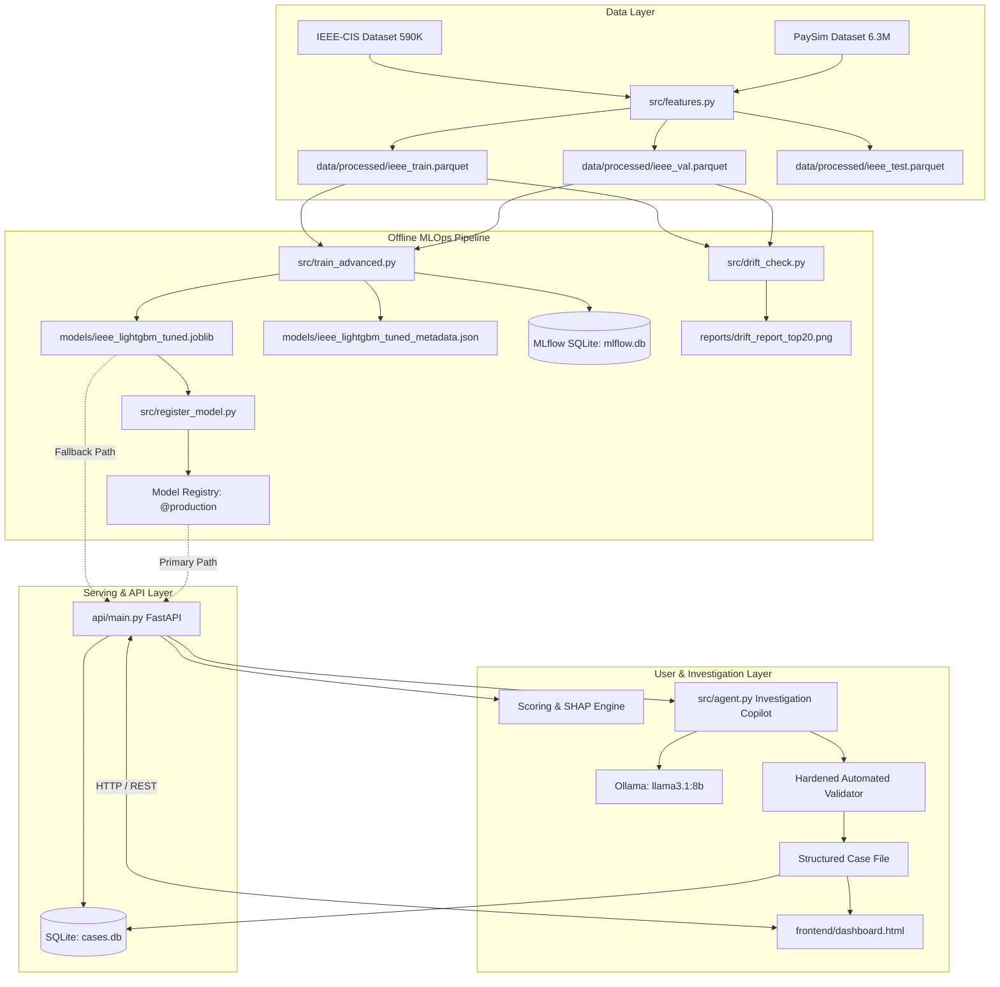
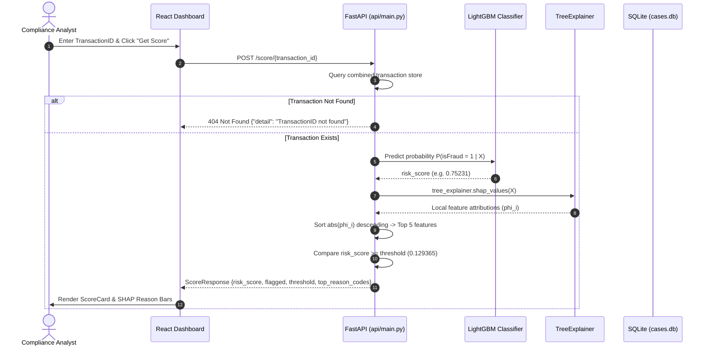
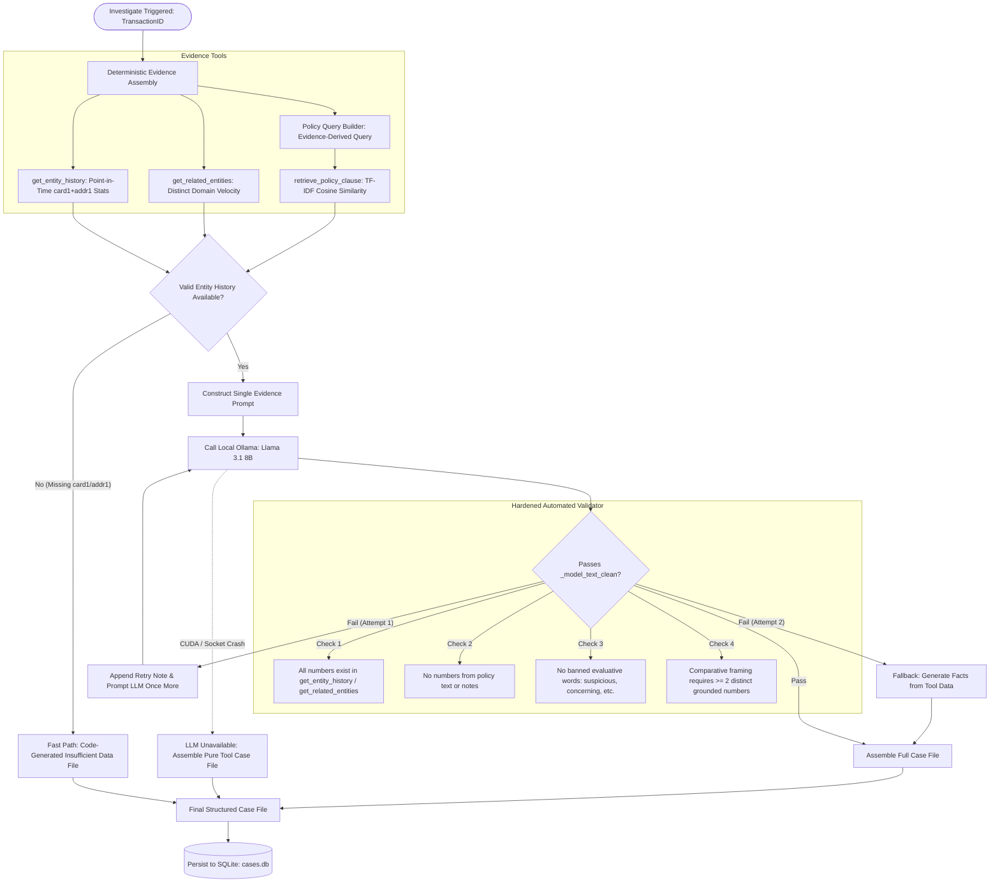
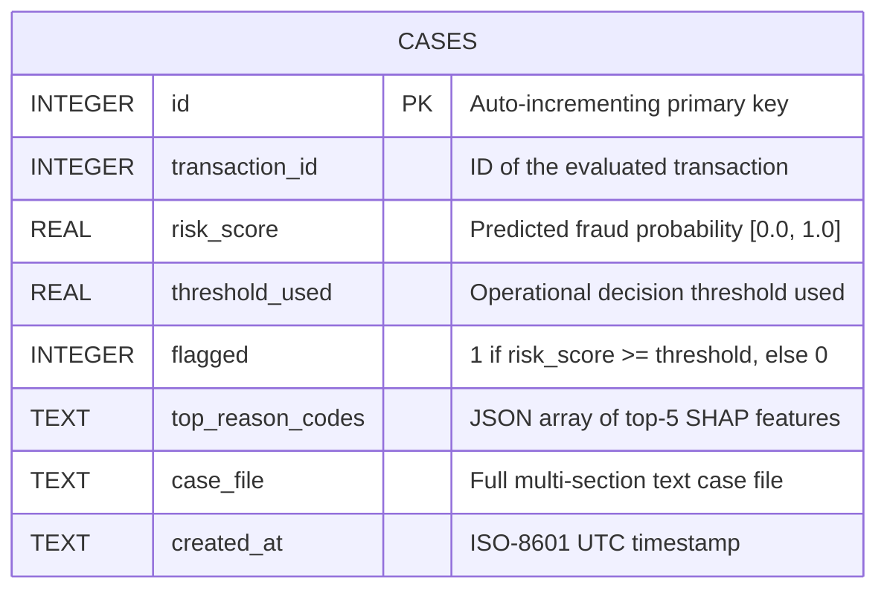

# FraudLens — Technical Architecture & Component Interaction Specification

**Document Version:** 1.0  
**Author:** Dhanraj Shitole  
**Target Audience:** Software Architects, AI/ML Engineers, Technical Examiners  

---

## 1. Architectural Philosophy: The Decoupled Hybrid Pattern

Production financial compliance platforms face two conflicting requirements:
1. **Low Latency & High Mathematical Rigor:** Scoring transactions must occur in milliseconds, with fully deterministic, auditable probability calculations and exact feature attributions.
2. **Context-Rich Narrative Synthesis:** Compliance officers need readable case summaries cross-referencing multi-table histories and company policy guidelines.

Attempting to solve both with an end-to-end Large Language Model fails because generative models are inherently non-deterministic, computationally expensive, and susceptible to hallucination. Attempting to solve both with traditional rule engines fails because complex fraud rings evade static thresholds and rules lack narrative flexibility.

**FraudLens resolves this tension through a Decoupled Hybrid Pattern:**
- **Code makes decisions; models score; LLMs narrate.**
- Machine learning (LightGBM) outputs the numerical fraud probability and flags alerts against an empirical false-positive budget.
- SHAP (TreeExplainer) deterministically decomposes predictions into exact feature contributions.
- Deterministic Python tools query point-in-time entity histories and execute vector-space policy matching with strict relevance floors.
- The Local LLM (Llama 3.1 8B via Ollama) is constrained to writing exactly two sentences (`ENTITY SUMMARY` and `TOP RISK FACTORS`).
- An automated validator inspects all generated text; any failure drops directly to a deterministic, code-assembled case file.

---

## 2. Global System Architecture



---

## 3. Data Ingestion & Preprocessing Architecture

### 3.1 Leakage-Safe Time-Based Partitioning
Random $k$-fold cross-validation allows past transactions to be predicted using future behavioral statistics, introducing lookahead leakage. FraudLens enforces chronological partitioning:

```
Timeline: ─────────────────────────────────────────────────────────────► (TransactionDT)
[─────────── 70% Train ───────────][───── 15% Val ─────][──── 15% Held-Out Test ────]
  Fit Encoders, Resample (SMOTE),    Hyperparameter Tuning,     Single-Pass Generalization,
  Train Gradient Boosted Trees      Threshold Calibration       Brier Calibration, Verification
```

### 3.2 Feature Engineering Pipeline (`src/features.py`)
1. **Temporal Decoding:** `TransactionDT` represents elapsed seconds from an arbitrary date. It is transformed into cyclical temporal variables (hour-of-day, day-of-week).
2. **Missing Value Handling:** Missing categorical variables are encoded as `'missing'`; missing numerical values are filled with `-999`, accompanied by binary missingness indicators.
3. **Frequency Encoding:** High-cardinality categorical variables (`card1`, `card2`, `addr1`, `P_emaildomain`) are mapped to frequency distributions computed strictly over the training set.
4. **Entity Aggregations:** Grouping by `(card1, addr1)` creates composite entity behavioral metrics:
   $$\mu_{\text{amt}} = \frac{1}{|E|} \sum_{i \in E} \text{TransactionAmt}_i$$
   $$\sigma_{\text{amt}} = \sqrt{\frac{1}{|E|} \sum_{i \in E} (\text{TransactionAmt}_i - \mu_{\text{amt}})^2}$$
   Where $E = \{ \text{transactions} \mid \text{card1}_i = \text{card1}_t \land \text{addr1}_i = \text{addr1}_t \land \text{DT}_i \le \text{DT}_t \}$.

---

## 4. Machine Learning & Explainability Pipeline



### 4.1 Threshold Selection under Asymmetric Loss
Because false positives inflict analyst fatigue and legitimate customer churn, FraudLens fixes the operational threshold $\tau$ at a strict **2.0% false-positive budget** on the validation set:
$$\tau = \text{Percentile}_{98} \left( \{ \hat{p}_i \mid y_i = 0, i \in \text{Validation} \} \right)$$
For IEEE-CIS, this empirically yields $\tau = 0.129365$. On the held-out test set, this fixed threshold intercepts 53.39% of all fraud (Recall) at a 43.95% Precision and 2.46% empirical FP rate.

---

## 5. Agentic AI Investigation Architecture (`src/agent.py`)

The investigation copilot is deliberately tool-scoped and read-only. It gathers evidence deterministically, invokes a local LLM for narrative formatting, validates all claims against ground truth, and falls back gracefully upon failure.



### 5.1 The Four Guardrails Against Hallucination
1. **Point-in-Time Temporal Gate:** `get_entity_history` filters strictly to `TransactionDT <= this transaction`. Transactions occurring at the same timestamp or later are excluded, preventing current and future label leakage.
2. **Tuple-Scoped Granularity:** `get_related_entities` groups by `(card1, addr1)` together rather than `addr1` alone, preventing regional code collisions.
3. **Evidence-Driven Policy Retrieval:** Policy search queries are constructed from actual tool counts (e.g. `distinct_email_domains_last_30_days > 3`), and a relevance floor (0.15 cosine similarity) prevents weak matches from being cited.
4. **Automated Validator (`_model_text_clean`):** Rejects comparative framing (*greater than, less than, higher than, lower than, more than, above, below, compared to, versus, relative to, than the overall/average/typical/mean*) unless the same sentence contains at least two distinct grounded numbers.

---

## 6. Serving Backend Architecture (`api/main.py`)

The FastAPI service exposes 5 asynchronous endpoints, utilizing a startup lifecycle (`lifespan`) to load models and data into a shared memory state dictionary (`_state`).

### 6.1 Dual Model-Loading Strategy
```
Application Startup:
       │
       ▼
Try: MLflow Registry Lookup
"models:/fraudlens-ieee-lightgbm@production"
       │
       ├───────────────────────────────┐
       ▼ (Success)                     ▼ (Exception / Missing URI)
Loaded from Registry            Log Warning & Load Joblib:
_state["model_source"] =        "models/ieee_lightgbm_tuned.joblib"
"registry:...@production"       _state["model_source"] = "joblib-fallback"
```

### 6.2 Endpoint Inventory

| Endpoint | HTTP Method | Request Input | Response Output | Description |
|---|---|---|---|---|
| `/health` | `GET` | None | `HealthResponse` | Reports service status, model load flag, model type, and `model_source`. |
| `/score/{id}` | `POST` | `transaction_id: int` | `ScoreResponse` | Returns risk probability, boolean `flagged`, threshold used, and top-5 SHAP reason codes. |
| `/investigate/{id}` | `POST` | `transaction_id: int` | `InvestigateResponse` | Executes scoring and agent investigation, logs record to SQLite, returns full case file and `case_id`. |
| `/cases` | `GET` | `limit: int = 20` | `list[CaseSummary]` | Lists recent investigations from SQLite ordered by descending ID. |
| `/cases/{id}` | `GET` | `case_id: int` | `CaseDetail` | Fetches complete historical case record including reason codes and case file. |

---

## 7. Database Entity-Relationship Specification

FraudLens uses a zero-configuration SQLite database (`cases.db`) configured with `PRAGMA journal_mode=WAL` for robust concurrent reads.



---

## 8. MLOps & Drift Architecture (`src/drift_check.py`)

The Population Stability Index (PSI) evaluates distributional stability across all 545 modeling features between the baseline training distribution ($P$) and the temporal validation split ($Q$):

$$\text{PSI} = \sum_{b=1}^{B} \left( Q_b - P_b \right) \times \ln\left( \frac{Q_b}{P_b} \right)$$

```
Quantile Binning on Reference (Train):
  Bin 1      Bin 2      Bin 3             Bin B
[──────────][──────────][──────────] ... [──────────]
    │          │          │                  │
Compare observed proportion in Validation:
   Q_1        Q_2        Q_3                Q_B
    │          │          │                  │
    └──────────┴──────────┴──────────────────┴──────► Calculate Sum: PSI Value
```

- $\text{PSI} < 0.10$: Stable; no shift (**535 features**).
- $0.10 \le \text{PSI} < 0.25$: Moderate shift; monitor (**2 features**).
- $\text{PSI} \ge 0.25$: Significant shift; alert (**7 genuine features**).
- *Artifact Detection:* `TransactionDT` exhibited $\text{PSI} = 8.28$, correctly diagnosed by our pipeline as a split artifact rather than genuine behavioral drift.

---

## 9. CI/CD & Deployment Topology

```mermaid
graph LR
    subgraph GitHub
        PR[Pull Request / Push to main] --> GHA[GitHub Actions Runner]
    end

    subgraph CI Pipeline (.github/workflows/ci.yml)
        GHA --> S1[Python 3.13 Setup & Cache]
        S1 --> S2[pip install -r requirements.txt]
        S2 --> S3[compileall: Bytecode Syntax Check]
        S3 --> S4[HTML Parser: dashboard.html Validation]
        S4 --> S5[pytest tests/ - 51 Tests]
        S5 --> S6[docker build -t fraudlens-api]
    end

    subgraph Deployment Target
        S6 -.-> DEPLOY[Container Registry / Host Deployment]
    end
```

